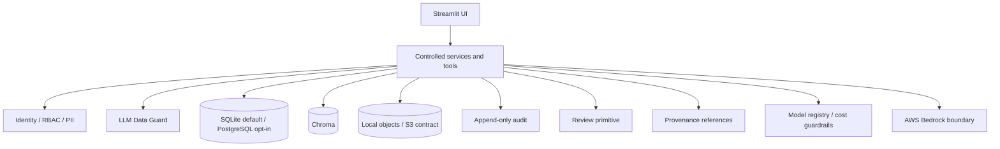

# Ada Architecture

This document records the platform, security, and canonical-data boundaries implemented
through Phase 1. The broader target architecture and delivery sequence remain in
[`roadmap_v3.md`](../roadmap_v3.md).

## Component boundary

Streamlit is presentation-only. Agents and pages never receive a raw SQL function or direct
database connection. Only platform and domain service code may use the database boundary.

## Local-first storage

- `ADA__DB_URL` defaults to SQLite; a `postgresql://` URL enables the optional Postgres
  adapter.
- Chroma persists under `ADA__CHROMA_PATH`.
- Original files and generated artifacts use `ObjectStore`; Phase 0 implements
  `LocalObjectStore`, while the S3 adapter remains a Phase 19 contract.
- File intake stores and registers uploads but does not parse them into domain records.

## Canonical relational boundary

Phase 1 adds typed canonical entities under `ada.domain`, temporal repositories under
`ada.persistence`, and secured application services under `ada.services`. The repository layer
is not exposed to agents or Streamlit pages. Service reads enforce RBAC and field-level PII
filtering; governed writes add audit, provenance, and version-aware `AdaState` references.

Schema changes are forward-only migrations under `ada.migrations`. The migration ledger stores
SHA-256 checksums and rejects modified history, version gaps, and unknown-ahead databases.
SQLite uses a write transaction while PostgreSQL uses a transaction-scoped advisory lock.
Migration `0001` adopts existing Phase 0 databases; migration `0002` preserves Phase 0 documents
while adding canonical tables and immutable entity history.

Mutable entities require an `expected_version` update/delete precondition. Each successful
mutation closes the previous history interval, creates the next version, and keeps the current
table synchronized. Delete is a tombstone mutation; `as_of` reads reconstruct prior versions.
National identifiers cross an encryption-codec boundary and canonical storage has no plaintext
identifier field.

## Identity, authorization, and PII

Development identity comes from `ADA__DEV_USER` and `ADA__DEV_ROLE`. Application services
enforce a deterministic role × permission matrix for `viewer`, `editor`, `approver`, and
`admin`. Field filtering uses `public`, `internal`, and `sensitive` PII tiers. Application-user
OIDC is an interface hook until Phase 19.

Authorization answers whether a user may access a record. The LLM Data Guard separately
applies deny-by-default, purpose-specific `ALLOW`, `MASK`, `REDACT`, or `DENY` decisions so a
model receives only fields needed for its task.

## Agent and document safety

- Uploaded content is untrusted data, never instructions.
- `sanitize_untrusted()` removes control characters and neutralizes common embedded
  instruction phrases; `wrap_untrusted()` creates a data-only delimiter.
- Agents request capabilities rather than model IDs. The registry resolves capability ×
  budget tier to current Bedrock IDs and applies bounded token, loop, timeout, and retrieval
  settings.
- Required processing, authorization, provenance, audit, and high-impact review do not
  disappear in lower budget tiers.

## Review, provenance, and audit

`ReviewRequest` and `ApprovalDecision` provide a persistent lifecycle that intake and
high-impact canonical writes can reference. `SourceRef`, `EvidenceRef`, and `ProvenanceRef`
persist independently and link to a specific canonical entity version before the complete
Phase 7 evidence engine exists.

Audit events append to `<data_path>/audit/audit.jsonl` and include actor, action, entity,
before/after version summaries, source, outcome, correlation ID, expected/current version,
review request, provenance references, model/prompt context, confidence, and change-set IDs.

## Secrets, retention, and deletion

The default secrets backend reads environment variables. AWS Secrets Manager and SSM remain
adapter contracts for Phase 19. Secret values are never included in `AdaConfig.describe()`,
logs, or the UI.

For local development, the Administration page can launch the AWS CLI's SSO device flow.
The launcher binds Streamlit to localhost, streams only display-safe CLI output, and never
copies AWS tokens or credential-cache files into the repository. This helper is removed when
application-user OIDC replaces development identity.

> **Production blocker:** remove the `AWS Session (Local Only)` tab and
> `ada.platform.aws_auth` before enabling non-local access. Production authentication must
> use application-user OIDC and workload identity; it must never display AWS credential
> values.

Local reset requires explicit confirmation plus `admin` permission. It clears SQLite, Chroma,
and object storage, reinitializes platform tables, and records the operation. Production
retention, legal hold, backup, and KMS policies are hardened in Phase 19; the initial audit
retention target is at least one year.

## Demo superuser mode

Demo mode lets a presenter exercise every implemented feature without ordinary role or
organization-scope limits, while leaving the production authorization architecture intact. It
is implemented in `ada.platform.demo` and resolved through the single `current_principal`
identity entry point.

- It is disabled by default (`ADA__DEMO_MODE`).
- The opt-in flag is necessary but never sufficient. Activation also requires a verifiably
  isolated environment: local SQLite (operational PostgreSQL is rejected), the environment
  secrets backend, and a dedicated `ADA__DEMO_DATA_DIR` that contains the database and all
  local stores (resolved through symlinks, so an escaping path is rejected). Resolution fails
  closed when isolation cannot be verified.
- The demonstration identity is a dedicated, gated `demo_superuser` role, not a production
  account. It cannot be selected through `ADA__DEV_ROLE`; attempting to do so outside verified
  demo mode is rejected.
- Demo writes still flow through the controlled services, so validation, audit, provenance,
  and review all apply; audit events attribute actions to `demo_superuser`.
- The UI shows a prominent DEMO badge, and the dedicated `scripts/run_demo.sh` launcher pins an
  isolated `.demo/` data directory, verifies isolation before starting, seeds synthetic data,
  and binds to localhost.

## CI/CD boundary

Pull-request CI uses frozen dependencies and no AWS credentials. It runs formatting/lint,
typing, SQLite unit tests, a disposable PostgreSQL migration/repository suite, dependency and
secret scanning, documentation checks, and a guard against tracked `data/`. Live Bedrock
testing is manual and uses a protected GitHub Environment with short-lived AWS OIDC
credentials. Phase 19 builds, scans, signs, and promotes one immutable container digest through
dev, staging, and production with health-based rollback.

Temporary dependency exceptions and their compensating controls are listed in
[`security_exceptions.md`](security_exceptions.md); unlisted advisories remain blocking.
