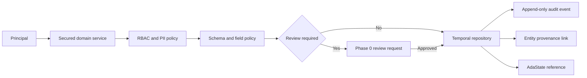

# Phase 1 — Canonical Domain Model

## 1. Purpose

Phase 1 establishes one governed, temporal source of truth for personnel, organizations,
training, due-outs, administrative actions, absences, and documents. It adds production-ready
domain and persistence contracts while keeping the application local-first.

Phase 1 builds on the Phase 0 security, review, provenance, audit, storage, and model-routing
boundaries. Those controls are reused rather than replaced.

## Implementation map

- Domain contracts: `src/ada/domain/`
- Forward-only migrations: `src/ada/migrations/`
- Temporal repositories: `src/ada/persistence/`
- Secured CRUD and organization services: `src/ada/services/`
- Entity-version provenance links: `src/ada/provenance/store.py`
- Deterministic loader: `src/ada/seed.py` and `scripts/seed_phase1.py`
- Synthetic normalized source: `samples/phase1_seed/`
- Read-only demos: `app/pages/3_Personnel.py` and `app/pages/4_Organization.py`
- SQLite, PostgreSQL, governance, hierarchy, fixture, and UI tests: `tests/`

## 2. Locked decisions

- SQLite is the default database; PostgreSQL is an opt-in compatibility target.
- Database changes use ordered, immutable SQL migrations with SHA-256 drift detection.
- Migrations only move forward. There are no automatic destructive down-migrations.
- Mutable records use optimistic concurrency through `expected_version`.
- Records are temporal: current-state reads support `as_of`, and delete operations are soft.
- Fixture and seed identifiers are deterministic UUIDv5 values.
- National identifiers are never stored in plaintext. The domain accepts only an encrypted
  value plus a display-safe suffix.
- Role checks, PII filtering, audit, provenance, and review are service-layer boundaries.
- Due-out schema and basic CRUD ship now; recurrence, escalation, and dashboards remain Phase 9.
- Administrative actions own absence records. A second absence entity is not introduced.
- The Phase 0 document registry is extended rather than duplicated.
- Reporting snapshots and report-specific `as_of` behavior remain Phase 11.
- Phase 1 UI is read-only: personnel list/detail and organization hierarchy/rollup demos.

## 3. Canonical entities

| Aggregate | Entities |
| --- | --- |
| Personnel | `Personnel`, `PersonnelAssignment`, `PersonnelContact` |
| Organization | `Organization`, `OrganizationRelationship` |
| Training | `TrainingCourse`, `TrainingRequirement`, `TrainingCompletion` |
| Due-out | `DueOut`, `DueOutAssignment` |
| Administrative | `AdministrativeAction`, `Absence` |
| Documents | Extended `DocumentRecord` |

All entities use canonical identifiers, lifecycle timestamps, version numbers, and a
classification level. Mutable history is preserved as immutable snapshots.

## 4. Field policy

Every governed field can be classified as:

- `REQUIRED` — must be present for a canonical record.
- `RECOMMENDED` — omission is accepted but produces a validation issue.
- `OPTIONAL` — omission is expected.
- `DEFAULTABLE` — a documented default may be applied and recorded.

Validation returns structured issues instead of silently discarding source data. Source values
that cannot be mapped remain available through document evidence and provenance references.

## 5. Temporal contract

Every mutation creates the next integer version with:

- `valid_from` set to the mutation time,
- `valid_to` left open for the current version,
- the prior version closed at that same time,
- `deleted_at` set only by a soft-delete mutation.

`get(id)` and `list()` return current, non-deleted records by default. Passing `as_of` returns
the version valid at that instant. Passing `include_deleted=True` permits tombstone reads.

Updates and deletes require `expected_version`. A stale value raises a concurrency conflict and
does not write partial history.

## 6. Organization semantics

- Organizations form a directed hierarchy through parent relationships.
- A child can have only one active primary parent at a point in time.
- A relationship cannot create a cycle or make an organization its own ancestor.
- Scope is the selected organization plus active descendants at `as_of`.
- Personnel rollups count active primary assignments in scope without double-counting a person.
- Inherited requirements resolve from the closest applicable ancestor, with the most-specific
  active rule winning.

## 7. Governance flow

High-impact mutations can be staged for review. Read operations return role-filtered records.
Audit events carry principal, entity, operation, outcome, correlation ID, and version context.
Provenance links each canonical entity/version to one or more Phase 0 evidence references.

## 8. Migration contract

Migration modules live under `src/ada/migrations/` and are named with a zero-padded version and
description. The runner:

1. creates the migration ledger if needed,
2. takes an advisory lock on PostgreSQL or a write transaction on SQLite,
3. verifies checksums for every previously applied migration,
4. rejects unknown database versions and edited history,
5. applies pending migrations in order and records each checksum atomically.

Migration `0001` adopts the Phase 0 schema. Migration `0002` adds Phase 1 canonical tables,
history tables, indexes, constraints, and provenance links. Existing local data is retained.

## 9. Deterministic demo data

Normalized fixtures live under `samples/phase1_seed/`. Stable UUIDv5 values are derived from a
fixed Ada namespace and semantic natural keys. Running the seed command repeatedly is
idempotent and produces the same identifiers on SQLite and PostgreSQL.

The dataset includes:

- a multi-level organization hierarchy,
- active and historical personnel assignments,
- training requirements and completions,
- due-outs and administrative records,
- an encrypted-identifier placeholder with no real PII,
- provenance links to synthetic Phase 0 documents.

Load it with `uv run python scripts/seed_phase1.py`. The loader is insert-only: existing stable
IDs are counted as skipped and are never overwritten.

## 10. Acceptance criteria

Phase 1 is complete when:

1. a Phase 0 SQLite database upgrades without data loss;
2. migration drift and unknown-ahead versions fail safely;
3. SQLite and PostgreSQL execute the same migration and repository suites;
4. all canonical entities round-trip through typed services;
5. stale updates fail without changing history;
6. `as_of` queries reproduce prior record and hierarchy state;
7. delete operations create recoverable tombstones;
8. hierarchy cycles and duplicate active primary parents are rejected;
9. rollups are deterministic and do not double-count people;
10. national identifiers cannot be written as plaintext;
11. service reads enforce RBAC and field-level PII filtering;
12. governed writes create audit and provenance records;
13. fixtures seed idempotently with deterministic IDs;
14. read-only personnel and organization demos render from canonical services;
15. lint, type checking, tests, dependency audit, docs validation, and secret scan pass.

## 11. Deferred work

- Conversational create/update/delete UI: Phase 3
- General ingestion and mapping: Phases 4–5
- Training operational workflows: Phase 10
- Due-out recurrence, escalation, dashboards, and My Work: Phase 9
- Administrative action workflows: Phase 12
- Report snapshots and generated reporting: Phase 11
